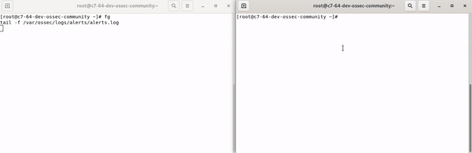
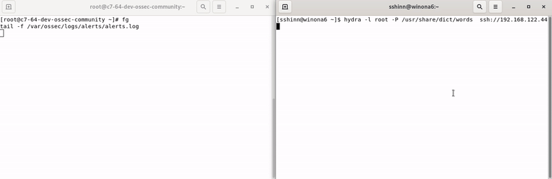

OSSEC v4.5.0 

# Information about OSSEC 

OSSEC is a full platform to monitor and control your systems. It mixes together 
all the aspects of HIDS (host-based intrusion detection), log monitoring and 
SIM/SIEM together in a simple, powerful and open source solution.

Visit our website for the latest information.  [www.ossec.net](https://www.ossec.net)

## Current Releases 

The current stable releases are available on the ossec website. 

* Releases can be downloaded from: [Downloads](https://www.ossec.net/downloads/)
* Release documentation is available at: [docs](https://www.ossec.net/docs/)

## Development ##

The development version is available on GitHub:

## Screenshots ##

*File Integrity Monitoring*

*Attack Detection*

## Help / Support ##

Join us on slack, ossec.slack.com: Invites to slack@ossec.net

## Credits and Thanks ##

* OSSEC bundles upstream zlib, cJSON, PCRE2, and Lua, and includes cryptographic routines from OpenSSL and SSLeay.
* This product includes software developed by the OpenSSL Project for use in the OpenSSL Toolkit (https://www.openssl.org/).
* This product includes cryptographic software written by Eric Young (eay@cryptsoft.com).
* This product includes software developed by the zlib project (Jean-loup Gailly and Mark Adler).
* This product includes software developed by the cJSON project (Dave Gamble).
* This product includes software developed by the PCRE2 project (Philip Hazel and contributors).
* This product includes software developed by the Lua project (Lua.org, PUC-Rio).
* [Atomicorp](https://www.atomicorp.com) sponsors OSSEC development and hosts the annual OSSEC Conference (OSSEC Con).

## License

OSSEC is licensed under the [GNU General Public License version 2 (GPLv2)](LICENSE).

